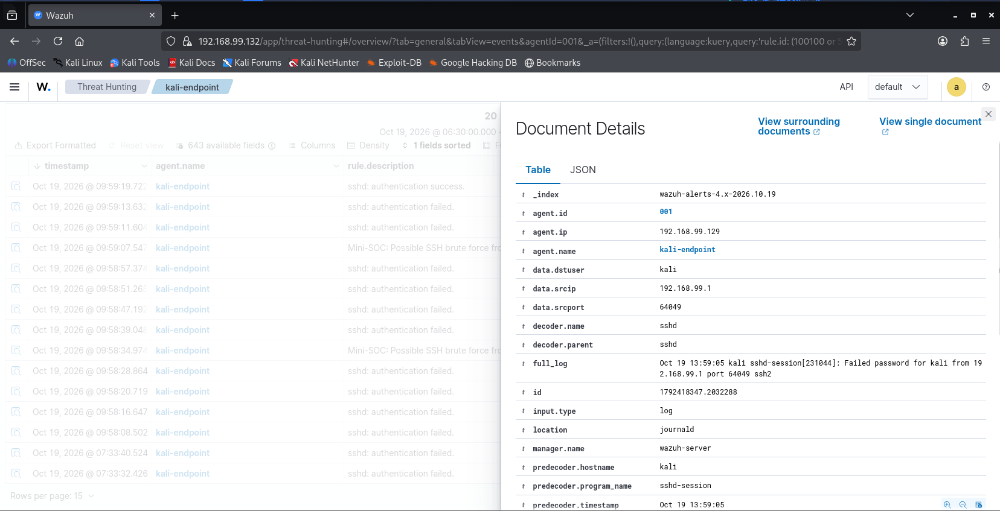
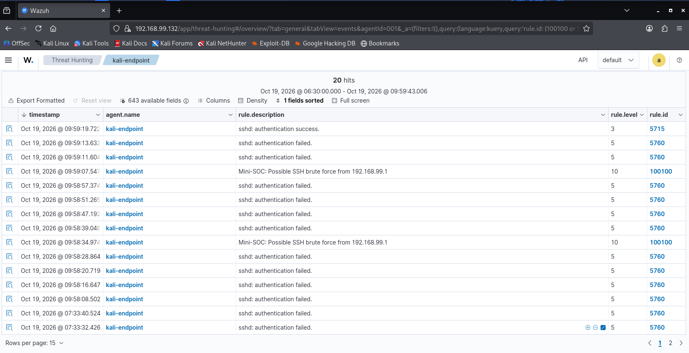
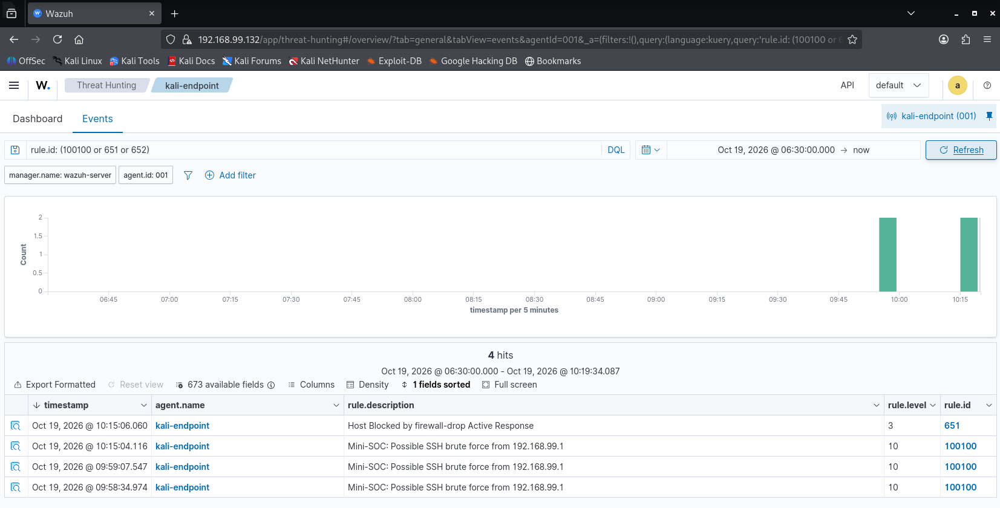
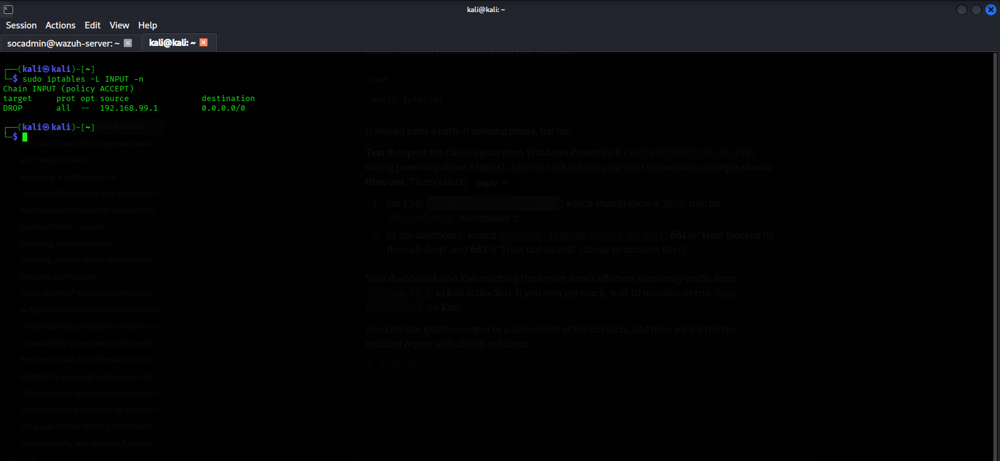
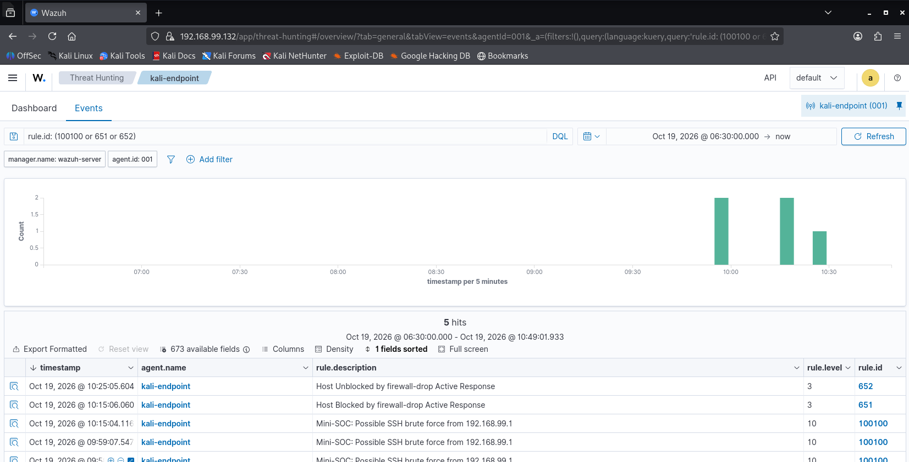

# Mini SOC with Wazuh

A small, working Security Operations Center built with **Wazuh 4.14.9** in a VMware lab. One authorized endpoint is monitored, security events are collected, custom detection rules are written and tested, and an automated response blocks the attacker. The result is documented as an **Alert → Investigation → Evidence → Response** incident report.

> **Lab only.** Every system in this project is owned by the author and runs on an isolated VMware network. The "attack" is a manual password-guessing test against my own VM.

## Architecture

```
Windows host 192.168.99.1  (simulated attacker, OpenSSH client)
        |
        |  SSH (port 22)
        v
Kali VM "kali-endpoint" 192.168.99.129  --- Wazuh agent v4.14.9 --->  Wazuh server 192.168.99.132
 (monitored endpoint)                                                  manager + indexer + dashboard
                                                                       Ubuntu Server 24.04.5
```

| Role | System | Address |
|---|---|---|
| SIEM server | Ubuntu Server 24.04.5 LTS, Wazuh 4.14.9 all-in-one (4 vCPU, about 5 GB RAM, 48 GB disk) | 192.168.99.132 |
| Monitored endpoint | Kali GNU/Linux 2026.3, agent `kali-endpoint` (ID 001) | 192.168.99.129 |
| Attacker (simulated) | Windows host | 192.168.99.1 |

## What was built

- Wazuh server (manager, indexer, dashboard) and one enrolled agent
- Log collection from journald (sshd, sudo, useradd), File Integrity Monitoring on `/etc/ssh`, and CIS configuration assessment
- Five custom detections mapped to MITRE ATT&CK
- Automated response (Active Response, `firewall-drop`) with automatic unblock
- A full incident investigation report

## Custom detection rules

| Rule | Level | Detects | MITRE ATT&CK |
|---|---|---|---|
| 100100 | 10 | SSH brute force: 5 failed logins from one IP within 120 s | T1110 Brute Force |
| 100110 | 12 | New local user account created | T1136.001 Local Account |
| 100120 | 8 | Root shell obtained via sudo | T1548.003 Sudo and Sudo Caching |
| 100130 | 12 | `/etc/ssh/sshd_config` modified (FIM) | T1562.001 Impair Defenses |

Rule file: [`rules/local_rules.xml`](rules/local_rules.xml)

## Results

| Test | Result |
|---|---|
| SSH brute force (12 failed logins in about 65 s) | Rule 100100 fired at 09:58:34 and 09:59:07 |
| Successful login right after the failures | Rule 5715 at 09:59:19 (the pattern a SOC escalates) |
| Active Response | Rule 651 two seconds after 100100 (10:15:04 to 10:15:06); `iptables` showed a DROP for the attacker IP; SSH attempts timed out |
| Automatic unblock after 600 s | Rule 652 at 10:25:05; firewall chain empty again |
| New user created | Rule 100110 at 08:40:05 |
| `sshd_config` edited and reverted | Rule 100130 at 09:44:16 and 09:44:27 |

Times are Wazuh dashboard times; raw endpoint logs are 4 hours ahead of the dashboard display. Full detail: [`test-plan.md`](test-plan.md) and the report in [`reports/`](reports/).

### Tuning notes

- Rule 100120 originally missed a user's first sudo because Wazuh classifies it as built-in rule 5403. Adding 5403 as a parent fixed it.
- The custom brute-force rule fired earlier than built-in rule 5763 and fired reliably in the live test.

## Evidence

Full evidence index: [`docs/screenshots/README.md`](docs/screenshots/README.md). Full write-up: [`reports/incident-report-001.md`](reports/incident-report-001.md).

**Alert 100100 fires for the brute-force attack** (source 192.168.99.1, target account `kali`, MITRE T1110):



**Failures, custom alerts, then a successful login:**



**Automated response: attacker IP blocked two seconds after the alert:**





**Block lifted automatically after 10 minutes:**



## Repository layout

```
mini-soc-wazuh/
├── README.md
├── test-plan.md
├── rules/local_rules.xml
├── configs/
│   ├── active-response.xml
│   └── agent-fim-snippet.xml
├── docs/screenshots/        (evidence E1 to E9)
└── reports/incident-report-001.md
```

## Reproduce it

1. Create an Ubuntu Server 24.04 VM and install Wazuh with the assisted installer from the official Wazuh quickstart (check <https://documentation.wazuh.com> for the current stable command).
2. Deploy an agent on an endpoint from the dashboard (Endpoints, Deploy new agent).
3. Add the rules from `rules/local_rules.xml` to `/var/ossec/etc/rules/local_rules.xml` on the server, then run `/var/ossec/bin/wazuh-analysisd -t` and `systemctl restart wazuh-manager`.
4. Add `configs/agent-fim-snippet.xml` inside the `<syscheck>` block of the agent's `ossec.conf`, and restart the agent.
5. Add `configs/active-response.xml` to the server's `ossec.conf`, and restart the manager.
6. Test each rule with `wazuh-logtest`, then live (see `test-plan.md`).

## Limitations

- Single monitored endpoint; manual attack, not a tool-driven one
- Thresholds are tuned for a lab, not production traffic
- No email or ticketing integration
- Active Response blocks only the offending IP on that endpoint

## Skills demonstrated

Wazuh, SIEM, log collection, detection engineering, MITRE ATT&CK mapping, File Integrity Monitoring, Active Response, incident investigation and reporting.
